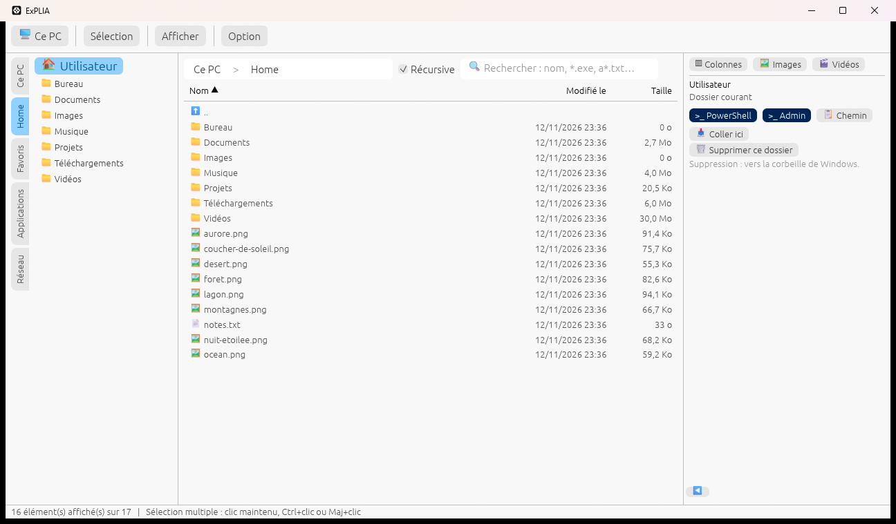
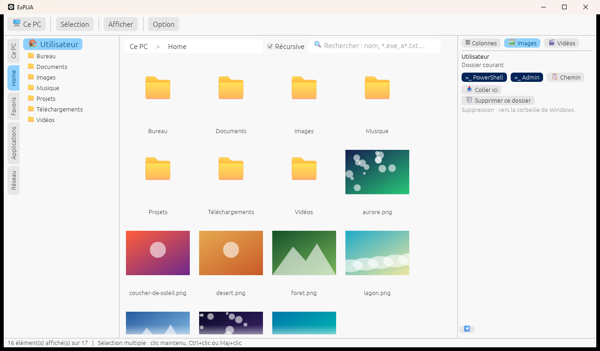

<div align="center">

# ExPLIA

**L'explorateur de fichiers Windows nouvelle génération.**
Rapide, natif, écrit en Rust — un seul `explia.exe`, rien à installer.

[](https://github.com/innov-lia/explia/actions/workflows/ci.yml)
[](https://github.com/innov-lia/explia/releases)


[](LICENSE)
[](https://github.com/innov-lia/explia/stargazers)

[**Télécharger**](https://github.com/innov-lia/explia/releases) · [Fonctionnalités](#fonctionnalités) · [Raccourcis](#raccourcis-clavier) · [Compiler](#pour-les-développeurs) · [English](#in-english)



</div>

ExPLIA réunit dans une seule fenêtre ce qu'on va d'habitude chercher dans plusieurs outils : une navigation au clavier très rapide, trois façons de voir un dossier (liste, colonnes « style Mac », grilles d'images et de vidéos), des aperçus et un lecteur vidéo intégrés, une recherche récursive, la chasse aux **doublons** et aux **dossiers vides**, l'occupation des disques en un coup d'œil, des onglets, PowerShell à portée de clic… tout en restant **prudent avec vos fichiers** : rien n'est jamais écrasé, et la suppression passe toujours par la corbeille, après confirmation.

> ⭐ **ExPLIA vous plaît ? Laissez une étoile au dépôt** : c'est ce qui nous aide le plus à le faire connaître.

## Les points forts

- 🗂 **Barre latérale en classeur** : des intercalaires *Ce PC*, *Home*, *Favoris*, *Applications* et *Réseau*, avec l'**occupation de chaque disque** (barre colorée et pourcentage).
- ⚡ **Navigation éclair** au clavier : flèches, Retour arrière, `..`, fil d'Ariane cliquable, onglets (Ctrl+T).
- 🔎 **Recherche** par nom avec jokers (`*.exe`, `img_??.png`), **récursive** dans les sous-dossiers, résultats au fil de l'eau.
- 👁 **Trois affichages** : liste détaillée triable, colonnes « style Mac » et grilles de miniatures (images ou vidéos).
- 🎬 **Aperçu et lecture intégrés** : images, texte, archives ZIP, audio et vidéo (via VLC), **plein écran** d'un double-clic.
- 🧹 **Nettoyage** : dossiers vides, **doublons** (même contenu) et **gros fichiers** (> 50 Mo, réglable), classés du plus gros au plus petit, supprimés en un clic (vers la corbeille).
- 📋 **Copier, couper, coller, glisser-déposer** avec l'Explorateur et le Bureau, **sans jamais écraser** un fichier existant ; **nouveau dossier** et **propriétés** Windows en un clic.
- `>_` **PowerShell** ouvert directement dans le dossier, normal ou administrateur.
- 🔒 **Aucune télémétrie, aucune connexion réseau.** Vos réglages restent dans un simple fichier texte.

## Télécharger et lancer

1. Ouvrez la page des [**versions**](https://github.com/innov-lia/explia/releases) et téléchargez le fichier `explia-…-windows-x64.zip` de la dernière version.
2. Décompressez-le et lancez `explia.exe` : il n'y a rien à installer.

Prérequis : Windows 10 ou 11, 64 bits. Windows peut afficher un avertissement SmartScreen (l'exécutable n'est pas signé) : « Informations complémentaires » puis « Exécuter quand même ». La somme SHA-256 du zip est donnée dans la page de la version.

> La version publiée `v0.1.0` est la première préversion ; les fonctionnalités décrites ci-dessous correspondent à la branche de développement. Pour les avoir avant la prochaine version, [compilez ExPLIA](#pour-les-développeurs) (une commande).

Facultatif : installez [VLC](https://www.videolan.org) (3.x, 64 bits) pour **lire les vidéos et les sons dans ExPLIA** (voir [Lecture audio et vidéo](#lecture-audio-et-vidéo--vlc-facultatif)).

## L'interface en un coup d'œil

```
┌──────────────────────────────────────────────────────────────────────────────┐
│ 🖥 Ce PC │ Afficher │ Option │ 🗂 onglet 1 × │ 🗂 onglet 2 ×                   │  barre de menus
├───┬──────────────┬─────────────────────────────────────────┬─────────────────┤
│ C │ 🏠 pphal      │ Home > Documents ☑ Récursive 🔍 ⏷Sélection│ ▥  🖼  🎬        │
│ e │  📁 Bureau    │ Nom ▲                 Modifié le  Taille │ aperçu, lecture  │
│   │  📁 Documents │ ⬆ ..                                      │ ou actions du    │
│ P │  📁 Vidéos    │ 📁 Projets            12/11/2026  2,1 Go │ dossier          │
│ C │               │ 🖼 photo.jpg          10/11/2026  3,4 Mo │ (PowerShell…)    │
│ … │ intercalaires │ liste, colonnes ou grille                │ ◀ échange        │
└───┴──────────────┴─────────────────────────────────────────┴─────────────────┘
```

<p align="center"></p>

## Fonctionnalités

### Navigation
- Au lancement, ExPLIA ouvre **votre dossier utilisateur**. La fenêtre s'ouvre à 80 % de l'écran, centrée, puis sa taille est mémorisée (au moins 900 × 450).
- **Barre d'adresse** (en haut de la zone centrale) : fil d'Ariane cliquable (`Ce PC > D: > Projets > …`) dont chaque mot s'illumine au survol. Dans votre dossier utilisateur, le chemin commence par `Home` (`Ce PC > Home > Vidéos`) plutôt que `C: > Users > nom`. Un clic sur l'espace libre permet de saisir un chemin (`C:\Users`, `D:`, `Ce PC`) ; Entrée valide, Échap annule.
- **Ligne `..`** en tête de liste pour remonter ; **Retour arrière** ou **←** aussi (le dossier quitté est resélectionné). Double-clic ou **→** pour entrer dans un dossier.
- **Onglets** : clic droit sur un dossier « 🗂 Ouvrir dans un nouvel onglet », ou **Ctrl+T** pour le dossier affiché. Les onglets s'affichent dans la barre de menus après **Option** ; un clic en change, « × » ou **Ctrl+W** le ferme.
- La zone centrale n'affiche jamais la liste des lecteurs : « Ce PC » (bouton de la barre de menus, fil d'Ariane, ou **←** au plus haut d'un lecteur) ouvre l'intercalaire *Ce PC* de la barre latérale.

### Barre latérale en « classeur »
La barre latérale, à gauche, montre la liste de l'intercalaire choisi ; les intercalaires sont sur son bord gauche (ou droit, au choix).
- **Ce PC** : les lecteurs (`C:`, `D:`…) avec leur nom de volume et une **barre d'occupation** avec le pourcentage à l'intérieur (verte, orange dès 75 %, rouge dès 90 %). L'infobulle donne le type, le format (NTFS…), la capacité, l'espace utilisé et libre.
- **Home** : votre dossier utilisateur (🏠 et votre nom, un clic l'ouvre) et ses sous-dossiers.
- **Favoris** : vide au départ ; clic droit sur un dossier « Ajouter aux favoris » / « Retirer des favoris ».
- **Applications** : ExPLIA en tête, puis les programmes que vous ajoutez (clic droit sur un `.exe`, `.bat`, `.cmd`, `.msi` ou `.com` > « Ajouter aux applications »). Un clic lance ; clic droit : lancer en administrateur (UAC), afficher dans son dossier, retirer.
- **Réseau** : les lecteurs réseau connectés (lettres de lecteur).
- **Au clavier** : après un clic sur un lecteur, un dossier de Home ou un favori, **↑ / ↓** ouvrent l'élément précédent / suivant de la liste et **→** rend la main au dossier.

### Recherche
- Barre de recherche à droite de la barre d'adresse (**Ctrl+F**, **Échap** pour effacer). Un mot est cherché dans le nom (`rapport`, `.exe`) ; `*` et `?` sont des jokers sur le nom entier (`*.exe`, `img_??.png`) ; plusieurs motifs se séparent par `,` ou `;` (`*.mkv, *.avi`). Majuscules et minuscules sont indifférentes.
- **☑ Récursive** (cochée par défaut) : la recherche parcourt aussi tous les sous-dossiers, en arrière-plan ; les résultats (5 000 au plus) apparaissent au fur et à mesure, avec leur dossier d'origine. Décochée, la recherche filtre simplement le dossier affiché.
- Les liens et jonctions ne sont jamais suivis ; la recherche s'efface quand on change de dossier.

### Affichages
- **Liste** (par défaut) : nom, taille (celle des dossiers est calculée en arrière-plan), date de modification. Le menu **Afficher** ajoute la date de création, les **dimensions** des images, la **résolution** et la **durée** des vidéos et des sons (lues dans les en-têtes : MP4/MOV/M4A, MKV/WebM, AVI, WAV, MP3, FLAC, OGG/Opus).
- **Tri d'un clic sur un en-tête** (Nom, Créé le, Modifié le, Taille) ; un second clic inverse l'ordre, une flèche ▲ / ▼ marque le tri actif.
- **▥ Colonnes « style Mac »** : une colonne de largeur fixe par niveau du chemin (un nom trop long se termine par « … »), la dernière avec taille, dates et en-têtes triables. Dans Home, les colonnes commencent sous votre dossier (l'intercalaire Home en tient lieu). Ctrl+clic / Maj+clic fonctionnent dans toutes les colonnes, renommer (F2) et clic droit aussi.
- **🖼 Images** et **🎬 Vidéos** : une grille avec seulement les images (miniatures décodées au fil de l'eau) ou seulement les vidéos du dossier. Hors de Home, une colonne des lecteurs (si l'intercalaire *Ce PC* ne les montre pas déjà) et une colonne de navigation (`..` et sous-dossiers) l'accompagnent ; dans Home, la grille prend toute la place et les sous-dossiers y sont des tuiles.
- Un second clic sur ▥, 🖼 ou 🎬 revient à la liste. **Afficher** gère aussi les **dossiers et fichiers cachés** (attribut « caché » de Windows, et noms commençant par un point comme `.git`), masqués par défaut.

### Volet de détail, aperçu et lecture
- **Aperçu** des images (PNG, JPEG, BMP, GIF, WebP), du texte (`.txt`, `.md`, `.json`, `.rs`, `.log`…, 64 Ko au plus) et du **contenu des archives ZIP** (rien n'est extrait). Pour les autres types : type, taille et bouton « Ouvrir ».
- **Lecture audio et vidéo intégrée** (VLC, voir plus bas) : « ▶ Lire », double-clic ou Entrée ; lecture / pause (bouton ou **Espace**), arrêt, position, volume ; « ↗ Lecteur externe » pour l'application par défaut.
- **Vidéo en plein écran** : double-clic sur la vidéo ; commandes en bas, double-clic ou **Échap** pour revenir.
- **◀ Triangle d'échange** (en bas du volet latéral) : le volet de détail passe au centre, en grand, et la navigation sur le côté ; un clic sur le triangle les remet en place.
- **Actions sur un dossier** (dossier sélectionné, ou dossier affiché quand rien n'est sélectionné) : **>_ PowerShell** et **>_ Admin** (console ouverte dans ce dossier ; administrateur via UAC), **📋 Chemin**, **📁 Nouveau dossier**, **📥 Coller dans ce dossier**, **Propriétés**, renommer, **🗑 Supprimer** (y compris le dossier affiché lui-même).

### Fichiers : sélection et actions
- **Sélection multiple** : **Ctrl+clic**, **Maj+clic** (ou **Maj+↑/↓**), ou **clic maintenu** puis un clic par élément. Un seul type à la fois (dossiers ou fichiers).
- **Renommer** : **F2**, bouton ou clic droit, directement dans la liste ; l'extension n'est pas sélectionnée, les noms interdits par Windows sont refusés et un élément existant n'est jamais écrasé.
- **Supprimer** : **Suppr**, bouton ou clic droit, **vers la corbeille** (récupérable). « Supprimer » devient « Confirmer » à la même place ; au clavier Suppr puis Entrée, Échap annule. Sur un partage réseau ou un disque amovible, Windows n'a pas de corbeille : la confirmation l'indique, et Windows demande lui-même son accord avant de supprimer définitivement.
- **Copier** (clic droit, bouton, **Ctrl+C**) : les fichiers vont dans le presse-papiers de Windows, à coller dans l'Explorateur, sur le Bureau ou ailleurs. **Copier le chemin** : le chemin complet en texte.
- **Couper** (clic droit, bouton, **Ctrl+X**) : les éléments apparaissent en grisé ; le prochain collage les **déplace** (dans ExPLIA comme dans l'Explorateur).
- **Coller** (**Ctrl+V**, clic droit « 📥 Coller dans ce dossier », bouton du volet de détail) : copie ou déplace, en arrière-plan, les fichiers du presse-papiers (d'ExPLIA ou de l'Explorateur) dans le dossier. **Jamais d'écrasement** : l'élément arrivé prend le nom « nom - Copie », « nom - Copie (2) »… Entre deux lecteurs, un déplacement copie d'abord tout, et l'original n'est retiré qu'après une copie complète et sans erreur.
- **Nouveau dossier** (**Ctrl+Maj+N**, bouton du volet de détail, clic droit sur un dossier) : crée « Nouveau dossier » (ou « Nouveau dossier (2) »…) et le passe aussitôt en renommage.
- **Propriétés** (**Alt+Entrée**, clic droit, bouton) : la fenêtre « Propriétés » de Windows.
- **Menus contextuels** : seules les commandes pertinentes s'affichent (fichier, dossier, exécutable, multi-sélection) et celles que la source permet.
- **Glisser-déposer** : appuyez sur une ligne ou une tuile et faites glisser vers le Bureau ou l'Explorateur (copie) ; à l'inverse, déposez dans ExPLIA des fichiers venus de l'Explorateur : ils sont copiés dans le dossier affiché, avec les mêmes règles que Coller.
- **Ouvrir** : double-clic (application par défaut). Clic droit sur un exécutable : « Exécuter » ou « Exécuter en tant qu'administrateur » (UAC).

### Nettoyage : dossiers vides, doublons et gros fichiers
Filtre **⏷ Sélection**, à droite de la barre de recherche, selon l'option **Récursive** :
- **📂 Dossiers vides** : liste et **sélectionne** les dossiers sans aucun fichier (des sous-dossiers vides ne comptent pas). Il ne reste qu'à cliquer sur « Supprimer ».
- **📑 Doublons > [50] Mo** : liste les fichiers de **même contenu** (même taille, puis même empreinte du contenu) au-dessus du seuil, réglable, **du plus gros au plus petit**. Les copies sont groupées (`#1`, `#2`…) avec leur dossier d'origine ; **« Sélectionner les copies »** garde le premier fichier de chaque groupe et sélectionne les autres.
- **📦 Fichiers > [50] Mo** : liste les fichiers plus gros que le seuil (réglable), **du plus gros au plus petit**, avec leur taille totale. Rien n'est sélectionné d'office.
- Pour un résultat, le volet de détail montre son **emplacement** : chaque dossier parent avec **↗ Ouvrir** (pour y aller, puis remonter) et **🗑** (supprimer ce dossier entier, corbeille avec confirmation). Idéal pour éliminer d'un coup un dossier rempli de doublons.

### Personnalisation et réglages
- **Afficher > Disposition** : intercalaires et volet de détail à gauche ou à droite.
- **Option** : « Pas de calcul de taille de dossier » (gros disques), « Occupation des disques » (barres de l'intercalaire *Ce PC*).
- Tout est mémorisé automatiquement dans `%APPDATA%\ExPLIA\settings.txt` (format `clé=valeur`, modifiable à la main) : taille de la fenêtre, tri, affichage, colonnes, éléments cachés, disposition, échange des volets, options, récursivité, seuils des doublons et des gros fichiers, favoris et applications.

## Raccourcis clavier

| Touche ou geste | Action |
| --- | --- |
| **↑ / ↓** | Élément précédent / suivant ; **Maj+↑/↓** étend la sélection |
| **←** / **Retour arrière** | Dossier parent ; au plus haut d'un lecteur, **←** donne la main à la liste des lecteurs |
| **→** | Entre dans le dossier sélectionné (ou rend la main au dossier depuis la barre latérale) |
| **↑ / ↓** (barre latérale) | Après un clic sur un lecteur, un dossier de Home ou un favori : précédent / suivant, ouvert aussitôt |
| **Grilles** | ↑ ↓ ← → se déplacent dans la grille, **Entrée** ouvre |
| **Entrée** | Ouvre (grilles) ; confirme une suppression |
| **F2** | Renomme l'élément sélectionné |
| **Suppr**, puis **Entrée** | Supprime vers la corbeille ; **Échap** annule |
| **Ctrl+C** / **Ctrl+X** / **Ctrl+V** | Copie / coupe la sélection ; colle les fichiers du presse-papiers (sans écraser) |
| **Ctrl+Maj+N** | Nouveau dossier dans le dossier affiché |
| **Alt+Entrée** | Propriétés de l'élément sélectionné (ou du dossier affiché) |
| **Ctrl+F** | Va dans la recherche |
| **Ctrl+T** / **Ctrl+W** | Nouvel onglet / ferme l'onglet |
| **Espace** | Lecture / pause du lecteur intégré |
| **Échap** | Annule une saisie, une confirmation, la multi-sélection, le plein écran |
| **Ctrl+clic**, **Maj+clic**, **clic maintenu** | Sélection multiple |
| **Double-clic** | Ouvre un dossier ; lit un audio / une vidéo ; ouvre un fichier ; plein écran sur la vidéo |

## Sécurité et données

- **Aucune télémétrie, aucune connexion réseau, aucun compte.**
- ExPLIA ne touche à vos fichiers que sur une action explicite de votre part :
  - **renommer**, dans le même dossier, sans jamais écraser ;
  - **copier** (Coller, dépôt dans la fenêtre), sans jamais écraser, sans suivre les liens ni copier un dossier dans lui-même ;
  - **déplacer** (Couper puis Coller), sans jamais écraser ni déplacer un dossier dans lui-même ; entre deux lecteurs, l'original n'est retiré qu'après une copie complète ;
  - **créer un dossier**, sous un nom libre ;
  - **supprimer**, toujours **vers la corbeille** et après confirmation ; jamais de suppression définitive de sa propre initiative.
- Les recherches, dossiers vides, doublons et gros fichiers sont en **lecture seule**.
- Il lance une application ou PowerShell uniquement sur votre geste ; en administrateur, c'est Windows qui demande la confirmation (UAC).
- Le seul fichier qu'il écrit de lui-même est `%APPDATA%\ExPLIA\settings.txt`.

## Lecture audio et vidéo : VLC (facultatif)

ExPLIA n'embarque aucun lecteur. Pour lire les vidéos et les sons **dans ExPLIA**, il utilise la bibliothèque `libvlc.dll` d'un **VLC installé sur la machine** :

- **VLC 3.x en 64 bits** (<https://www.videolan.org>). VLC 32 bits et VLC 4 ne sont pas pris en charge.
- ExPLIA cherche VLC dans l'ordre : le dossier de la variable d'environnement `EXPLIA_VLC_DIR`, un dossier `vlc` à côté de `explia.exe` (VLC portable), puis `C:\Program Files\VideoLAN\VLC`.
- **Sans VLC**, tout le reste fonctionne : « ▶ Lire » ouvre le fichier avec l'application par défaut de Windows, et un message explique comment obtenir la lecture intégrée.
- VLC n'est pas redistribué (il est chargé à la demande) et ne reçoit que des fichiers locaux.

## Limites connues

- Préversion (0.1.0), testée sur Windows 11 uniquement ; exécutable non signé.
- Lecture intégrée vérifiée avec une vidéo AVI ; MP4, MKV et le son restent à valider plus largement.
- Pas de miniatures pour les vidéos (icône) ; pas de barre de progression pour Coller (bilan à la fin).
- Glisser vers l'extérieur : des éléments d'un même dossier à la fois, en copie seulement.
- Pas encore disponible : créer un fichier, historique précédent / suivant, onglets mémorisés d'une session à l'autre, navigation dans les partages réseau, connecteurs SharePoint et OneDrive (Microsoft Graph : architecture prête, connexion reportée).

## Contribuer

Les retours sont les bienvenus : [signalez un bug](https://github.com/innov-lia/explia/issues/new?template=bug_report.md), [proposez une idée](https://github.com/innov-lia/explia/issues/new?template=feature_request.md), ou lisez [CONTRIBUTING.md](CONTRIBUTING.md) pour proposer du code. Et si ExPLIA vous est utile, **une étoile ⭐ fait toute la différence**.

## Licence

ExPLIA est distribué sous [licence MIT](LICENSE) : vous pouvez l'utiliser, le modifier et le redistribuer librement, en conservant la mention de copyright.

## In English

**ExPLIA is a fast, modern file explorer for Windows 10/11, written in Rust** (`egui`/`eframe`), shipped as a single portable `explia.exe`.

- 🗂 Tabbed sidebar ("binder") with *This PC* (disk usage bars), *Home*, *Favorites*, *Applications* and *Network*.
- 🔎 Name search with wildcards (`*.exe`), optionally **recursive** through subfolders.
- 👁 List view with sortable headers, Mac-style **column view**, **image and video grids**.
- 🎬 Built-in previews (images, text, ZIP) and audio/video playback through an installed VLC, with full screen.
- 🧹 **Empty-folder and duplicate finder** (same content, configurable size threshold), one click to send them to the Recycle Bin.
- 📋 Copy, paste and drag-and-drop with File Explorer and the Desktop — **never overwrites** an existing file.
- `>_` Open **PowerShell** (or an admin PowerShell) right in the folder; tabs; full keyboard navigation.
- 🔒 No telemetry, no network access; deletions always go to the Recycle Bin after confirmation.

Released under the [MIT License](LICENSE). The interface is in French for now. ⭐ **If you like it, please star the repo!**

## Pour les développeurs

### Prérequis pour compiler

- Windows 10 ou 11, x86_64.
- [Rust stable](https://rustup.rs) (édition 2024, Rust 1.85 ou plus récent).
- Toolchain `x86_64-pc-windows-msvc` : *Visual Studio Build Tools* avec la charge de travail « Développement Desktop en C++ » (inclut le SDK Windows).
- Facultatif, pour la lecture intégrée : **VLC 3.x 64 bits**.

### Compilation et exécution

```bash
cargo run --release
```

L'exécutable est produit dans `target\release\explia.exe`. Le fichier `.cargo/config.toml` lie le runtime C de Microsoft **statiquement** (`-C target-feature=+crt-static`) : `explia.exe` fonctionne sans le « Visual C++ Redistributable ». Ne définissez pas `RUSTFLAGS` en compilant, car elle remplace ce réglage.

### Vérifications

```bash
cargo fmt --check
cargo check
cargo test
cargo clippy -- -D warnings
```

### Organisation du code

| Fichier | Rôle |
| --- | --- |
| `src/main.rs` | Point d'entrée, fenêtre `eframe`. |
| `src/app/mod.rs` | État de l'application : navigation, onglets, parcours, aperçus, lecteur, réglages. |
| `src/app/event_manager.rs` | Réception centralisée des événements egui (clics, double-clics, clic maintenu, glisser, clavier, dépôt) et déclaration de tous les raccourcis. |
| `src/app/action_manager.rs` | Catalogue des commandes (définies une fois : libellé, raccourci, action) et exécution des actions. |
| `src/app/context_menu_manager.rs` | Menus contextuels construits selon la sélection et les capacités de la source. |
| `src/app/ui/` | Dessin seulement : barres, barre latérale, liste, colonnes, grilles, volet de détail, éléments réutilisables. |
| `src/selection_manager.rs` | Sélection, multi-sélection (un seul type à la fois), ancre Maj+clic, éléments visés. |
| `src/storage_manager/` | Interface commune des sources (`Connector`), capacités, erreurs ; connecteur local (disques et partages SMB). |
| `src/clipboard_manager.rs` | Copier / Couper (références) et lecture du contenu à coller. |
| `src/fs_nav.rs` | Entrées de dossier (nom, taille, dates, caché), listage, fil d'Ariane (Home), niveaux de colonnes, taille d'un dossier. |
| `src/view.rs` | Tri, recherche par motifs (`*`, `?`), colonnes, modes d'affichage, défilement. |
| `src/scan.rs` | Parcours en lecture seule : recherche récursive, dossiers vides, doublons (empreintes), gros fichiers. |
| `src/copy.rs` | Copie et déplacement de fichiers et dossiers sans écrasement (Coller, dépôt, Couper). |
| `src/clipboard.rs` | Presse-papiers de Windows : liste de fichiers (`CF_HDROP`), lecture et écriture. |
| `src/dragdrop.rs` | Glisser vers une autre application (OLE `DoDragDrop`, copie seulement). |
| `src/fileops.rs` | Renommage (validation du nom Windows, refus d'écraser) et création de dossier. |
| `src/trash.rs` | Envoi à la corbeille (`SHFileOperationW` avec `FOF_ALLOWUNDO`). |
| `src/launch.rs` | Ouverture d'un fichier, lancement d'un exécutable ou de PowerShell (`ShellExecuteW`, UAC), fenêtre Propriétés. |
| `src/places.rs` | Lecteurs logiques, capacité, occupation, nom et format des volumes, dossier de l'utilisateur. |
| `src/preview.rs` | Aperçus : images, texte, archives ZIP, miniatures. |
| `src/media.rs` | En-têtes multimédia : dimensions, résolution, durée. |
| `src/player.rs` | Lecture audio / vidéo : chargement dynamique de libVLC (code `unsafe` isolé ici). |
| `src/favorites.rs` | Listes de chemins sans doublon (favoris, applications). |
| `src/settings.rs` | Fichier de réglages (`settings.txt`) : lecture, écriture, valeurs par défaut. |
| `src/dates.rs` | Dates à l'heure locale et durées. |
| `.cargo/config.toml` | Liaison statique du runtime C. |
